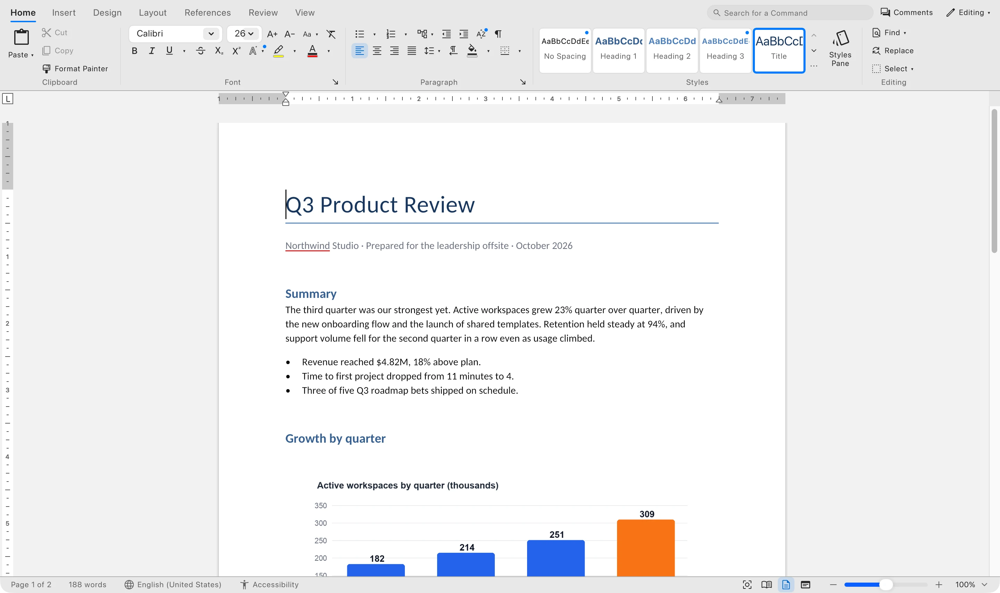
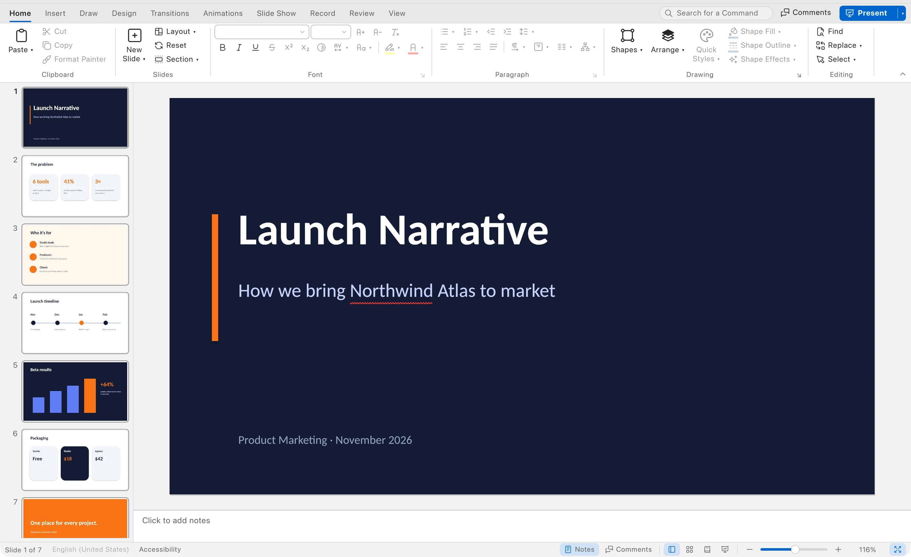
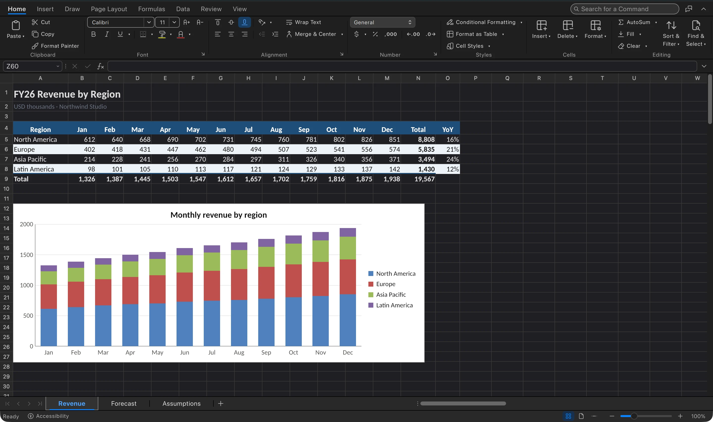

<p align="center">
  
  
  
  
</p>

<h1 align="center">Tav</h1>

<p align="center">
  <b>A fast, private office suite for documents, spreadsheets, presentations and PDFs.</b><br>
  Opens your Word, Excel, PowerPoint and PDF files directly. Free forever, works offline,<br>
  and one optional license unlocks the professional tools in every app.
</p>

<p align="center">
  <a href="https://github.com/reativelabs/tav/releases/latest"></a>
  
  
  <a href="https://gettav.com/pricing"></a>
</p>

<p align="center">
  <a href="#the-apps">The apps</a> ·
  <a href="#download">Download</a> ·
  <a href="#free-and-pro">Free and Pro</a> ·
  <a href="#screenshots">Screenshots</a> ·
  <a href="#uninstalling">Uninstalling</a> ·
  <a href="#privacy">Privacy</a> ·
  <a href="#verifying-your-download">Verifying downloads</a> ·
  <a href="#support">Support</a>
</p>

<br>

<p align="center">
  <picture>
    <source media="(prefers-color-scheme: dark)" srcset="images/screenshots/spreadsheets-dark.webp">
    
  </picture>
  <br>
  <sub>Tav Spreadsheets. Every app follows your system's light or dark appearance.</sub>
</p>

## Highlights

- **Works with the files you already have.** Open and save DOCX, XLSX, PPTX, OpenDocument and PDF files directly, with no conversion step and no upload.
- **Your documents stay on your computer.** There is no cloud service and no account to create. Every app works fully offline.
- **Native and fast.** Real desktop apps that start quickly and stay responsive with large files.
- **The same on every platform.** macOS, Windows and Linux get the same apps, the same tools and the same file formats.
- **Free forever, with one optional upgrade.** A single Tav Pro license adds the professional tools to all four apps on every platform.

## The apps

| | App | Use it for | File formats | |
| --- | --- | --- | --- | --- |
|  | **Tav Documents** | Letters, reports and long documents | DOCX, ODT, TXT; export to PDF | [Website](https://gettav.com/products/documents) |
|  | **Tav Spreadsheets** | Budgets, data analysis and charts | XLSX, ODS, CSV, TSV; export to PDF | [Website](https://gettav.com/products/spreadsheets) |
|  | **Tav Slides** | Presentations and slide shows | PPTX, ODP; export to PDF | [Website](https://gettav.com/products/slides) |
|  | **Tav PDF** | Reading, annotating, filling in and editing PDFs | PDF | [Website](https://gettav.com/products/pdf) |

Each app is installed separately, so you only download what you need.

## Download

Get the apps from **[gettav.com/download](https://gettav.com/download)** or from the [latest release](https://github.com/reativelabs/tav/releases/latest). In the file names below, `<App>` is `Documents`, `Spreadsheets`, `Slides` or `PDF`.

| System | Download | Then |
| --- | --- | --- |
| macOS 14.4+ (Apple Silicon) | `Tav-<App>-macOS.dmg` | Open it and drag the app into Applications. |
| Windows 10 (1809+) or 11, most PCs | `Tav-<App>-Windows-x64-Setup.exe` | Run it and follow the steps. The app appears in the Start menu. |
| Windows 11 on ARM (e.g. Snapdragon) | `Tav-<App>-Windows-arm64-Setup.exe` | Run it and follow the steps. The app appears in the Start menu. |
| Linux, most PCs | `Tav-<App>-Linux-x86_64.AppImage` | Make it executable (`chmod +x`), then run it. No installation needed. |
| Linux on ARM64 | `Tav-<App>-Linux-aarch64.AppImage` | Make it executable (`chmod +x`), then run it. No installation needed. |

Linux builds need glibc 2.38 or later: Ubuntu 24.04, Fedora 39, Debian 13 or newer. If an AppImage does not start, install FUSE 2 (Ubuntu: `sudo apt install libfuse2t64`).

> [!NOTE]
> The macOS apps are signed and notarized by Apple. The Windows installers are not code-signed yet, so Windows SmartScreen may show *"Windows protected your PC"* the first time you run one: choose **More info → Run anyway**. The warning only means the file has no code signature. To confirm your download is genuine first, see [Verifying your download](#verifying-your-download).

Updating is the same as installing: download the new version and install it over the old one. Your settings and your Tav Pro activation are kept.

## Free and Pro

**All four apps are free, with no time limit.** Create, edit, save, print and export to PDF without a trial, an account or a subscription.

**Tav Pro adds the professional tools to every app with a single license.** One purchase covers Tav Documents, Tav Spreadsheets, Tav Slides and Tav PDF on macOS, Windows and Linux. You never pay separately per app or per platform.

| | Free | Tav Pro |
| --- | :---: | :---: |
| All four apps on macOS, Windows and Linux | ✓ | ✓ |
| Create, edit, save, print and export to PDF | ✓ | ✓ |
| Professional tools, such as PDF editing, OCR and redaction, footnotes, advanced data tools and Presenter View | | ✓ |

Tav Pro is available as a monthly, yearly or lifetime plan. See [pricing](https://gettav.com/pricing).

> [!TIP]
> If a Pro plan ends, your work is unaffected. Every document, including content made with Pro tools, still opens, prints and saves in the free version. To move a license to another computer, choose **Settings ▸ Tav Pro ▸ Deactivate on This Computer**, then activate it on the new one, on any platform.

## Screenshots

<table>
  <tr>
    <td width="50%">
      <picture>
        <source media="(prefers-color-scheme: dark)" srcset="images/screenshots/documents-dark.webp">
        
      </picture>
    </td>
    <td width="50%">
      <picture>
        <source media="(prefers-color-scheme: dark)" srcset="images/screenshots/slides-dark.webp">
        
      </picture>
    </td>
  </tr>
  <tr>
    <td align="center"><sub>Tav Documents: reports and long documents, saved as Word files.</sub></td>
    <td align="center"><sub>Tav Slides: presentations that open and save as PowerPoint files.</sub></td>
  </tr>
  <tr>
    <td width="50%">
      <picture>
        <source media="(prefers-color-scheme: dark)" srcset="images/screenshots/pdf-dark.webp">
        
      </picture>
    </td>
    <td width="50%">
      <picture>
        <source media="(prefers-color-scheme: dark)" srcset="images/screenshots/spreadsheets-light.webp">
        
      </picture>
    </td>
  </tr>
  <tr>
    <td align="center"><sub>Tav PDF: read, annotate, fill in and sign PDFs.</sub></td>
    <td align="center"><sub>Tav Spreadsheets in the other appearance.</sub></td>
  </tr>
</table>

## Uninstalling

If you have Tav Pro and are removing Tav from a computer for good, first choose **Settings ▸ Tav Pro ▸ Deactivate on This Computer** so the license is free for another device.

| System | How |
| --- | --- |
| macOS | Drag the app from Applications to the Trash. |
| Windows | **Settings → Apps → Installed apps**, select the app, then **Uninstall**. |
| Linux | Delete the `.AppImage` file. |

Your documents are ordinary files and are never affected.

## Privacy

- **No account.** You never need to sign up or sign in to use Tav.
- **Your files stay local.** Documents are opened and saved on your computer. Tav has no cloud service and never uploads your files.
- **Tav Pro activation.** Only when you use Tav Pro does a small license helper contact the Tav license server: when you activate or deactivate a key, and about once a month to renew it. It sends your license key and an anonymous device ID, never your documents or file names.

## Verifying your download

Each release includes a `SHA256SUMS.txt` file listing the checksum of every installer. To confirm a download is complete and unmodified, compute its checksum and compare it with the list:

```sh
shasum -a 256 Tav-Documents-macOS.dmg               # macOS
sha256sum Tav-Documents-Linux-x86_64.AppImage       # Linux
Get-FileHash Tav-Documents-Windows-x64-Setup.exe    # Windows (PowerShell)
```

## Support

- **Documentation:** [gettav.com/docs](https://gettav.com/docs)
- **Release notes:** [gettav.com/changelog](https://gettav.com/changelog)
- **Contact:** [gettav.com/contact](https://gettav.com/contact)
