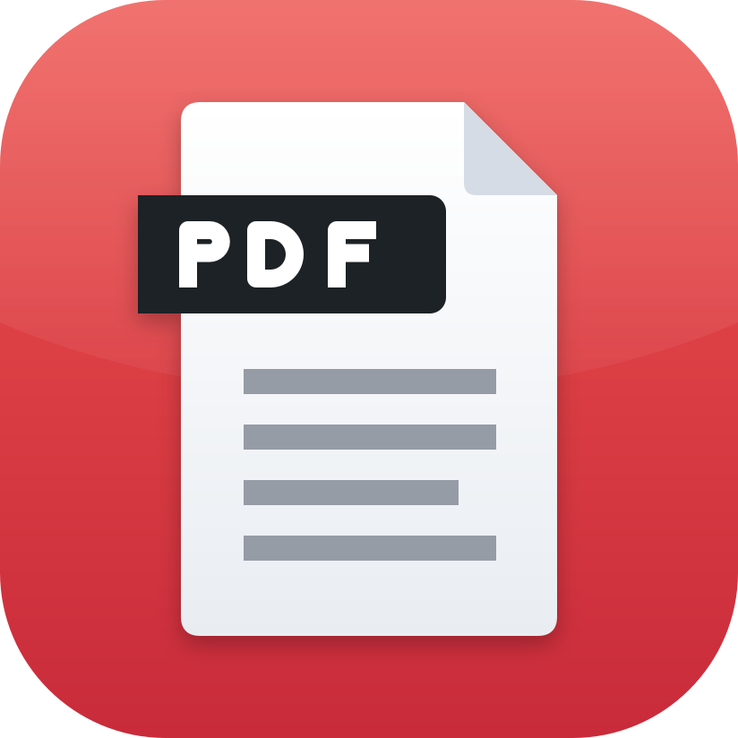
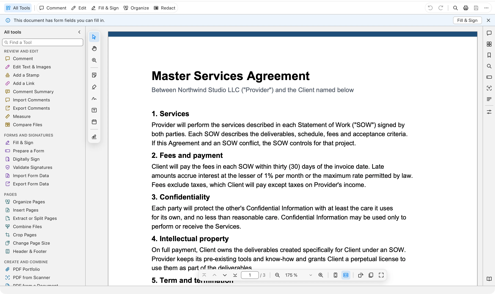

<p align="center">
  
  
  
  
</p>

<h1 align="center">Tav</h1>

<p align="center">
  A fast, private office suite for documents, spreadsheets, presentations and PDFs.<br>
  <b>Free forever</b> &nbsp;·&nbsp; <b>Works offline</b> &nbsp;·&nbsp; <b>macOS, Windows and Linux</b>
</p>

<p align="center">
  <a href="https://gettav.com/download"><b>Download</b></a> &nbsp;·&nbsp;
  <a href="https://gettav.com/pricing">Pricing</a> &nbsp;·&nbsp;
  <a href="https://gettav.com/docs">Documentation</a> &nbsp;·&nbsp;
  <a href="https://gettav.com/changelog">Release notes</a>
</p>

<picture>
  <source media="(prefers-color-scheme: dark)" srcset="images/screenshots/spreadsheets-dark.webp">
  
</picture>

## Why Tav

- **Works with the files you already have.** Open and save Word, Excel and PowerPoint files directly, with no conversion or upload.
- **Your documents stay on your device.** There is no cloud service and no account to create. The apps work fully offline.
- **Native desktop apps.** Fast to start and responsive with large files, on every major operating system.

## The apps

| App | Use it for | File formats |
| --- | --- | --- |
|  **Tav Documents** | Letters, reports and long documents | DOCX, ODT, TXT; export to PDF |
|  **Tav Spreadsheets** | Budgets, data analysis and charts | XLSX, ODS, CSV, TSV; export to PDF |
|  **Tav Slides** | Presentations and slide shows | PPTX, ODP; export to PDF |
|  **Tav PDF** | Reading, annotating, filling in and editing PDFs | PDF |

Each app is installed separately, so you only download what you need.

## Free and Pro

**All four apps are free, with no time limit.** You can create, edit, save, print and export to PDF without a trial, an account or a subscription.

**Tav Pro adds professional tools to every app with a single license.** One purchase covers Tav Documents, Tav Spreadsheets, Tav Slides and Tav PDF on macOS, Windows and Linux. You never pay separately per app or per platform.

| | Free | Tav Pro |
| --- | :---: | :---: |
| All four apps on macOS, Windows and Linux | ✓ | ✓ |
| Create, edit, save, print and export to PDF | ✓ | ✓ |
| Professional tools, such as PDF editing, OCR and redaction, footnotes, advanced data tools and Presenter View | | ✓ |

Tav Pro is available as a monthly, yearly or lifetime plan. See [pricing](https://gettav.com/pricing).

If a Pro plan ends, your work is unaffected. Every document, including content made with Pro tools, still opens, prints and saves in the free version.

## Download

Download from **[gettav.com/download](https://gettav.com/download)**, or pick a file from the [latest release](https://github.com/reativelabs/Tav-Releases/releases/latest).

| Platform | File | System requirements |
| --- | --- | --- |
| macOS | `Tav-<App>-macOS.dmg` | macOS 14.4 or later, Apple Silicon (M1 or later) |
| Windows (most PCs) | `Tav-<App>-Windows-x64-Setup.exe` | Windows 10 version 1809 or later, or Windows 11; Intel or AMD processor |
| Windows on ARM | `Tav-<App>-Windows-arm64-Setup.exe` | Windows 11 on an ARM processor, such as Snapdragon |
| Linux (most PCs) | `Tav-<App>-Linux-x86_64.AppImage` | Ubuntu 24.04, Fedora 39, Debian 13 or newer (glibc 2.38+); Intel or AMD processor |
| Linux on ARM | `Tav-<App>-Linux-aarch64.AppImage` | Same distributions as above, on an ARM64 processor |

`<App>` is `Documents`, `Spreadsheets`, `Slides` or `PDF`.

## Installation

**macOS**
1. Open the downloaded `.dmg` file.
2. Drag the app into the Applications folder.
3. Open it from Applications or Launchpad.

The apps are signed and notarized by Apple.

**Windows**
1. Run the downloaded installer and follow the steps.
2. Open the app from the Start menu.

Windows SmartScreen may show "Windows protected your PC" the first time. Select **More info**, then **Run anyway**.

**Linux**
1. Make the file executable: `chmod +x Tav-*.AppImage`, or enable "Allow executing file as program" in the file's properties.
2. Double-click the file to start the app. No installation is required.

If the app does not start, install FUSE 2 (Ubuntu: `sudo apt install libfuse2t64`).

## Screenshots

**Tav Documents**

<picture>
  <source media="(prefers-color-scheme: dark)" srcset="images/screenshots/documents-dark.webp">
  
</picture>

**Tav Slides**

<picture>
  <source media="(prefers-color-scheme: dark)" srcset="images/screenshots/slides-dark.webp">
  
</picture>

**Tav PDF**

<picture>
  <source media="(prefers-color-scheme: dark)" srcset="images/screenshots/pdf-dark.webp">
  
</picture>

## Verifying your download

Each release includes a `SHA256SUMS.txt` file listing the checksum of every installer. To confirm a download is complete and unmodified, compute its checksum and compare it with the list:

```sh
shasum -a 256 Tav-Documents-macOS.dmg               # macOS
sha256sum Tav-Documents-Linux-x86_64.AppImage       # Linux
Get-FileHash Tav-Documents-Windows-x64-Setup.exe    # Windows (PowerShell)
```

## Support

- **Documentation:** [gettav.com/docs](https://gettav.com/docs)
- **Release notes:** [gettav.com/changelog](https://gettav.com/changelog)
- **Contact:** [gettav.com/contact](https://gettav.com/contact)
