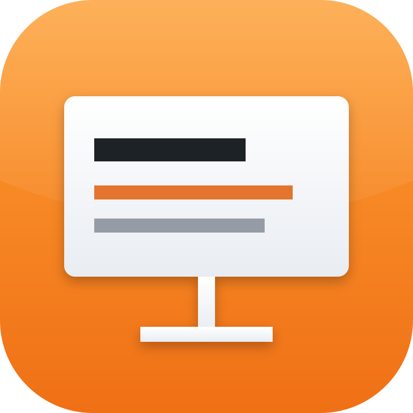
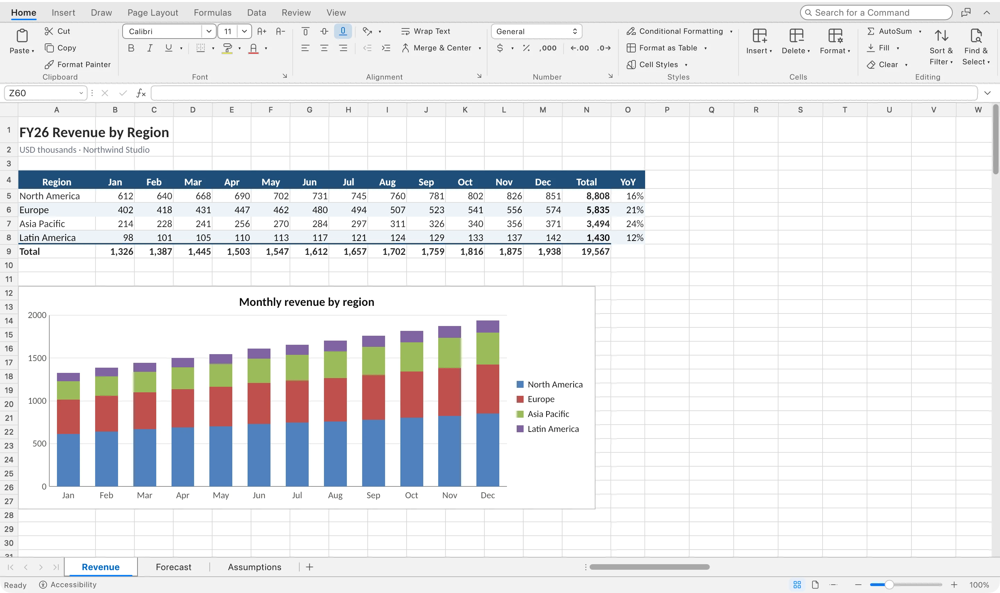

<p align="center">
  
  
  
  
</p>

<h1 align="center">Tav</h1>

Tav is the office suite that stays on your computer: four fast desktop apps for documents, spreadsheets, presentations and PDFs. Free to use, offline by design, with no account needed.

<picture>
  <source media="(prefers-color-scheme: dark)" srcset="images/screenshots/spreadsheets-dark.webp">
  
</picture>

This repository hosts the installers. Get the latest version from **[gettav.com/download](https://gettav.com/download)** or from **[Releases](https://github.com/reativelabs/Tav-Releases/releases/latest)**.

## The apps

| App | What it does | Formats |
| --- | --- | --- |
|  Tav Documents | Word processing | DOCX, ODT, TXT, PDF export |
|  Tav Spreadsheets | Spreadsheets and charts | XLSX, ODS, CSV, TSV, PDF export |
|  Tav Slides | Presentations | PPTX, ODP, PDF export |
|  Tav PDF | Reading, commenting and editing PDFs | PDF |

Each app is a separate download. Install only the ones you need.

## Screenshots

### Tav Documents

<picture>
  <source media="(prefers-color-scheme: dark)" srcset="images/screenshots/documents-dark.webp">
  
</picture>

### Tav Slides

<picture>
  <source media="(prefers-color-scheme: dark)" srcset="images/screenshots/slides-dark.webp">
  
</picture>

### Tav PDF

<picture>
  <source media="(prefers-color-scheme: dark)" srcset="images/screenshots/pdf-dark.webp">
  
</picture>

## Downloads

Replace `<App>` with `Documents`, `Spreadsheets`, `Slides` or `PDF`.

| Platform | File | Requirements |
| --- | --- | --- |
| macOS | `Tav-<App>-macOS.dmg` | macOS 14.4 or later, Apple Silicon (M1 or later) |
| Windows x64 | `Tav-<App>-Windows-x64-Setup.exe` | Windows 10 (1809) or 11, Intel or AMD |
| Windows ARM64 | `Tav-<App>-Windows-arm64-Setup.exe` | Windows 11 on ARM, e.g. Snapdragon |
| Linux x86_64 | `Tav-<App>-Linux-x86_64.AppImage` | glibc 2.38 or later (Ubuntu 24.04, Fedora 39, Debian 13 or newer) |
| Linux ARM64 | `Tav-<App>-Linux-aarch64.AppImage` | glibc 2.38 or later |

## Install

**macOS.** Open the .dmg and drag the app to Applications. The apps are signed and notarized by Apple.

**Windows.** Run the installer. If Windows shows "Windows protected your PC", choose **More info**, then **Run anyway**.

**Linux.** Make the AppImage executable (`chmod +x Tav-*.AppImage`), then run it. No installation is needed. If it doesn't start, install FUSE 2 (on Ubuntu: `sudo apt install libfuse2t64`).

## Verify a download

Each release includes `SHA256SUMS.txt`. Compare it with the fingerprint of the file you downloaded:

```sh
shasum -a 256 Tav-Documents-macOS.dmg                # macOS
sha256sum Tav-Documents-Linux-x86_64.AppImage        # Linux
Get-FileHash Tav-Documents-Windows-x64-Setup.exe     # Windows (PowerShell)
```

## Tav Pro

All four apps are free. One optional Tav Pro license (monthly, yearly or lifetime) unlocks the professional tools in every app, on macOS, Windows and Linux. See [gettav.com/pricing](https://gettav.com/pricing).

## Help

Guides and documentation: [gettav.com/docs](https://gettav.com/docs). Release notes: [gettav.com/changelog](https://gettav.com/changelog).
